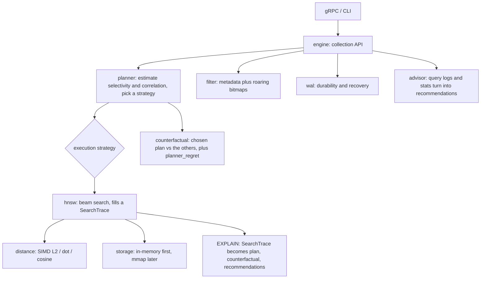

# Loupe

**A vector search engine that explains its filtered queries.**

Most vector databases can filter a search. Loupe goes further. It shows why a
query returned the results it did, what other search plans would have done, and
what to change when the results are weak.

Loupe answers the questions you actually ask when filtered search goes wrong:
- Why did this query miss good results?
- Was filtering after the search the wrong call?
- Do the rows that pass the filter sit far from what the query is looking for?
- Would a different search plan have done better?
- What should I change?

Loupe is its own engine, not a wrapper around someone else's. The parts you use
are the planner, `EXPLAIN SEARCH` (with the counterfactual), the advisor that
reads your query logs, and replay.

> Status: early development. This README grows as each milestone lands.

---

## Why Loupe?

Real search is rarely just vector search. You almost always search with filters:
a tenant id, a document type, a date range, permissions. HNSW is built to walk a
graph, and a filter can break the path it wants to take. Filtering before the
search and filtering after both fall down, just in different cases.

Other systems do filtered search, but they keep the reasoning hidden. They do
not show you the assumptions they made, the risk to recall, or what the other
plans would have done. Loupe does.

| | pgvector | Pinecone | Weaviate | Loupe |
|---|---|---|---|---|
| Filtered search | one fixed path, can pick wrong at scale | managed, hidden | HNSW plus ACORN, one fixed strategy | measures the query, picks from several strategies |
| Explainability | SQL `EXPLAIN` only | none | limited | `EXPLAIN SEARCH` plus the counterfactual: chosen plan next to the others |
| Hard filters (0.1% of rows, pulling away from the query) | recall and speed drop off | varies | ACORN helps | ACORN-style walk plus adaptive search width, picked per query |
| Cost | self-hosted | paid by usage | self-hosted or cloud | self-hosted, open |

In one line: Qdrant, Weaviate, and Pinecone do filtered search. Loupe lets you
inspect it, replay it, and tune it.

A short guide on when to pick Loupe over pgvector or Pinecone is coming once the
benchmarks are in.

---

## Architecture

---

## What you can run

| Command | What it answers |
|---|---|
| `loupe explain-search` | Why this result? Shows the chosen plan and the alternatives for one query. |
| `loupe advise` | What is wrong across my workload? Reads query logs and suggests fixes. |
| `loupe replay` | Did my change help? Replays a saved workload and reports before and after. |
| `loupe bench` | How does it compare? Runs test workloads and makes plots. |

There is also the Loupe Graph Explorer (optional, M12). It is a 3D web view of
one query's path. You watch the chosen plan walk the local graph next to the
plans it rejected, with the filtered-out nodes and the top results color-coded.

## Under the hood

The explaining only means something because the engine under it is real:
- HNSW index. A layered graph with beam search, built on a storage layer it can swap out.
- SIMD distance. NEON on Apple Silicon, AVX on x86, with a plain version as a fallback and a check.
- mmap storage. Search a sealed index on disk without loading all of it into memory.
- Write-ahead log. Crash recovery you can prove by killing the process mid-write.
- Deletes plus background compaction.

---

## Status

| Milestone | Scope | State |
|---|---|---|
| M0 | In-memory HNSW, SearchTrace, storage accessor, bench skeleton | ⬜ not started |
| M1 | SIMD distance kernels (NEON / AVX) | ⬜ |
| M2 | Filtered search: the strategies | ⬜ |
| M3 | Correlation-aware benchmark matrix plus arXiv corpus | ⬜ |
| M4 | Rule-based planner plus EXPLAIN SEARCH (counterfactual and regret) | ⬜ |
| M5 | Comparison vs FAISS / Qdrant / Weaviate / pgvector | ⬜ |
| M6 | Query-log advisor | ⬜ |
| M7 | Disk-backed storage (mmap) | ⬜ |
| M8 | WAL plus crash recovery | ⬜ |
| M9 | gRPC API and CLI (EXPLAIN plus advisor) | ⬜ |
| M10 | Deletes, dead-node-aware search, compaction | ⬜ |
| M11 | Cost-based planner | ⬜ |
| M11.5 | Polish: developer experience and metrics | ⬜ |
| M12 | (optional) Loupe Graph Explorer, 3D trace view | ⬜ |

Legend: ⬜ not started · 🟡 in progress · ✅ done. Links to PRs and issues go here as work lands.

---

## Results

Coming in M5: recall and speed plots against FAISS, Qdrant, Weaviate, and
pgvector, across the selectivity and correlation grid (synthetic plus arXiv). The
headline case is 0.1% of rows passing the filter while sitting far from the
query, where simple filtering falls apart and the planner pays off.

## EXPLAIN demo

Coming in M4: `loupe explain-search` on a hard filter, showing the chosen plan,
why it was chosen, and what the rejected plans would have cost.

## Quickstart

Coming soon: one command to build, load a dataset, run a query, and reproduce
the benchmarks from a fresh checkout.

---

## License

TODO.
