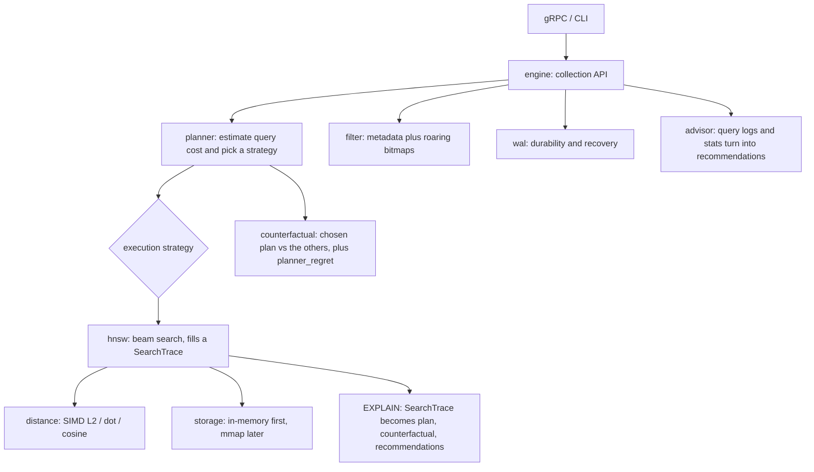

# Loupe

**A vector search engine that explains its filtered queries.**

Most vector databases can filter a search. Loupe goes further. It shows why a
query returned the results it did, what other search plans would have done, and
what to change when the results are weak.

Loupe answers the questions you actually ask when filtered search goes wrong:
- Why did this query miss good results?
- Was filtering after the search the wrong call?
- Do the rows that pass the filter sit far from what the query is looking for?
- Would a different search plan have done better?
- What should I change?

Loupe is its own engine, not a wrapper around someone else's. The parts you use
are the planner, `EXPLAIN SEARCH` (with the counterfactual), the advisor that
reads your query logs, and replay.

> Status: early development. This README grows as each milestone lands.

---

## Why Loupe?

Real search is rarely just vector search. You almost always search with filters:
a tenant id, a document type, a date range, permissions. HNSW is built to walk a
graph, and a filter can break the path it wants to take. Filtering before the
search and filtering after both fall down, just in different cases.

Other systems do filtered search, but they keep the reasoning hidden. They do
not show you the assumptions they made, the risk to recall, or what the other
plans would have done. Loupe does.

| | pgvector | Pinecone | Weaviate | Loupe |
|---|---|---|---|---|
| Filtered search | one fixed path, can pick wrong at scale | managed, hidden | HNSW plus ACORN, one fixed strategy | measures the query, picks from several strategies |
| Explainability | SQL `EXPLAIN` only | none | limited | `EXPLAIN SEARCH` plus the counterfactual: chosen plan next to the others |
| Hard filters (0.1% of rows, pulling away from the query) | recall and speed drop off | varies | ACORN helps | ACORN-style walk plus adaptive search width, picked per query |
| Cost | self-hosted | paid by usage | self-hosted or cloud | self-hosted, open |

In one line: Qdrant, Weaviate, and Pinecone do filtered search. Loupe lets you
inspect it, replay it, and tune it.

A short guide on when to pick Loupe over pgvector or Pinecone is coming once the
benchmarks are in.

---

## Architecture



---

## What you can run

| Command | What it answers |
|---|---|
| `loupe explain` | Why this result? Shows the chosen plan and the alternatives for one query. |
| `loupe advise` | What is wrong across my workload? Reads query logs and suggests fixes. |
| `loupe replay` | Did my change help? Replays a saved workload and reports before and after. |
| `loupe bench` | How does it compare? Runs test workloads and makes plots. |

There is also the Loupe Graph Explorer (optional, M12). It is a 3D web view of
one query's path. You watch the chosen plan walk the local graph next to the
plans it rejected, with the filtered-out nodes and the top results color-coded.

## Under the hood

The explaining only means something because the engine under it is real:
- HNSW index. A layered graph with beam search, built on a storage layer it can swap out.
- SIMD distance. NEON on Apple Silicon, AVX on x86, with a plain version as a fallback and a check.
- mmap storage. Search a sealed index on disk without loading all of it into memory.
- Write-ahead log. Crash recovery you can prove by killing the process mid-write.
- Deletes plus tombstone-aware compaction.

---

## Status

| Milestone | Scope | State |
|---|---|---|
| M0 | In-memory HNSW, SearchTrace, storage accessor, bench skeleton | ✅ done |
| M1 | SIMD distance kernels (NEON / AVX) | ✅ done |
| M2 | Filtered search: the strategies | ✅ done |
| M3 | Correlation-aware benchmark matrix plus arXiv corpus | ✅ done |
| M4 | Rule-based planner plus EXPLAIN SEARCH (counterfactual and regret) | ✅ done |
| M5 | Comparison vs FAISS / Qdrant / Weaviate / pgvector | 🟡 in progress |
| M6 | Query-log advisor | ✅ done |
| M7 | Disk-backed storage (mmap) | ✅ done |
| M8 | WAL plus crash recovery | ✅ done |
| M9 | gRPC API and CLI (EXPLAIN plus advisor) | ✅ done |
| M10 | Deletes, dead-node-aware search, compaction | ✅ done |
| M11 | Cost-based planner | 🟡 in progress |
| M11.5 | Polish: developer experience and metrics | ⬜ |
| M12 | (optional) Loupe Graph Explorer, 3D trace view | ⬜ |

Legend: ⬜ not started · 🟡 in progress · ✅ done. Links to PRs and issues go here as work lands.

---

## Results

First check, on the small SIFT set (10,000 vectors, 128 dimensions, 100 queries):
recall@10 is 0.997 under both L2 and cosine, at about 12,000 queries per second.
The search looks at roughly 660 vectors per query instead of all 10,000, so it is
already skipping most of the work. Numbers on the full million-vector set land
with the benchmark suite.

M5 is in progress. Loupe now exports matrix CSVs, Loupe-only SVG plots, external
baselines for FAISS, Qdrant, Weaviate, and pgvector, and a packaged `siftsmall`
smoke result. The next step is running the same shape on larger datasets and
real metadata. The headline case is 0.1% of rows passing the filter while
sitting far from the query, where simple filtering falls apart and the planner
pays off.

The benchmark runner also includes a compaction probe. It deletes a controlled
slice of a durable collection, reports tombstoned visits, distance work, latency,
and WAL bytes, then compacts and reports the same numbers again.

M11 has started. The live planner now scores `Flat`, `PostFilter`,
`InTraversal`, and `Acorn` with a cost model over selectivity, candidate count,
`k`, vector count, `ef`, correlation, and historical recall misses. The remaining
work is calibration against the benchmark matrix and replay logs. The benchmark
summary and replay command now keep the old M4 rule ladder as a baseline and
print recall, distance work, and regret for `RuleLadder` and `CostModel` side by
side. The first M11 calibration bundle is in
`bench/results/siftsmall-m11-calibration-2026-06-01/summary.md`; on that run,
`CostModel` matched `RuleLadder` at 0.995 mean recall, 936 mean distance work,
and 0.140 regret.

## EXPLAIN Reference Workflow

Build a durable collection from an embedded corpus, then explain a filtered query.
Run the commands with `cargo run -p loupe-cli --bin loupe -- <args>`, or
`cargo install --path crates/cli` to get a `loupe` binary.

```
loupe build --base datasets/arxiv/arxiv_base.jsonl --dir /tmp/loupe-arxiv
loupe explain --dir /tmp/loupe-arxiv --query datasets/arxiv/arxiv_query.jsonl \
  --index 0 --filter "category=math.PR"
```

For a small matching set, Loupe can pick `Flat` because the cost model sees exact
scan as cheaper than graph search. For a strict anti-correlated filter above the
flat-scan threshold, it should pick `Acorn+AdaptiveEf`. In both cases, the
counterfactual shows what the other plans would have cost:

```
chosen plan: Acorn+AdaptiveEf
plan            chosen   dist/query  returned recall (proxy)
Flat                         ...
PostFilter+AdaptiveEf       ...
InTraversal+AdaptiveEf      ...
Acorn+AdaptiveEf    yes     ...
risk flags: anti_correlated_filter
```

The key point is not only which plan won. It is that Loupe shows the rejected
plans next to the chosen one, with their cost and recall proxy.

Replay a saved workload and compare the old rule ladder with the live cost model:

```
loupe replay --dir /tmp/loupe-arxiv --query datasets/arxiv/arxiv_query.jsonl \
  --filter "category=math.PR" --out /tmp/loupe-query-log.jsonl \
  --compare-planners --planner-summary-csv /tmp/loupe-replay-planners.csv \
  --feedback-log /tmp/loupe-validation-log.jsonl
```

The replay log still records the live planner choice for each query. The optional
planner summary uses EXPLAIN counterfactuals to score `RuleLadder` and
`CostModel` on the same workload. If `--feedback-log` points at prior query logs
with `recall_smoke` values, replay feeds that historical miss rate into the cost
model before planning.

## Quickstart

Build and run the tests:

```
cargo test
```

Run the recall check on the small SIFT set:

```
bash scripts/download-datasets.sh siftsmall
cargo run --release -p loupe-bench --bin loupe-bench -- \
  datasets/siftsmall/siftsmall_base.fvecs \
  datasets/siftsmall/siftsmall_query.fvecs \
  datasets/siftsmall/siftsmall_groundtruth.ivecs \
  --matrix-csv /tmp/loupe-matrix.csv \
  --planner-summary-csv /tmp/loupe-planner-summary.csv \
  --plot-dir /tmp/loupe-plots
```

The CSV contains one row per selectivity and correlation cell, including the
engine, runner, strategy chosen, recall, distance work, latency, and returned
count.
The planner summary CSV records `RuleLadder` vs `CostModel` recall, distance
work, regret, and regret delta for M11 calibration.
The plot directory contains Loupe-only SVGs for fixed strategies vs the planner,
hard filter cells, where `Acorn+AdaptiveEf` wins, and where `Flat` wins.

Run the one-command benchmark suite when you want a packaged result bundle. The
runner uses the active Python interpreter for the external adapters. Use Python
3.11 or newer, and install the FAISS and competitor requirements in your venv
first when you pass `--engines all`.

```
python3.14 -m venv .venv
. .venv/bin/activate
python -m pip install -r scripts/requirements-faiss.txt -r scripts/requirements-competitors.txt
python bench/run_benchmark_suite.py \
  --dataset-name siftsmall \
  --base datasets/siftsmall/siftsmall_base.fvecs \
  --query datasets/siftsmall/siftsmall_query.fvecs \
  --groundtruth datasets/siftsmall/siftsmall_groundtruth.ivecs \
  --run-id siftsmall-smoke-2026-05-31 \
  --engines all
```

If your Python 3.11+ command has a different name, use that instead of
`python3.14`.

The suite writes temporary CSVs and plots under `/tmp/loupe-benchmark-suite/`,
starts and stops Docker services for Qdrant, Weaviate, and pgvector when those
engines are selected, then packages the final bundle under `bench/results/`.
Loupe runs also include a planner summary CSV in the result bundle.
It uses the first 10 query rows by default so larger datasets finish in a
reasonable time. Use `--query-limit 0` for every query row, and use
`--engines loupe,faiss` for a no-Docker run.

Run the first external baseline with FAISS:

```
python3.14 -m venv .venv
. .venv/bin/activate
python -m pip install -r scripts/requirements-faiss.txt
python bench/faiss_baseline.py \
  datasets/siftsmall/siftsmall_base.fvecs \
  datasets/siftsmall/siftsmall_query.fvecs \
  datasets/siftsmall/siftsmall_groundtruth.ivecs \
  --out /tmp/faiss-matrix.csv
```

FAISS does not expose HNSW distance-computation counts through its Python API, so
the FAISS CSV uses the searched candidate count as that column. It is still useful
for recall, latency, returned count, and side-by-side plots.

Run the Docker-backed baselines:

```
docker compose -f docker/benchmark-compose.yml up -d qdrant weaviate pgvector
python3.14 -m venv .venv
. .venv/bin/activate
python -m pip install -r scripts/requirements-competitors.txt
python bench/qdrant_baseline.py \
  datasets/siftsmall/siftsmall_base.fvecs \
  datasets/siftsmall/siftsmall_query.fvecs \
  datasets/siftsmall/siftsmall_groundtruth.ivecs \
  --out /tmp/qdrant-matrix.csv
python bench/weaviate_baseline.py \
  datasets/siftsmall/siftsmall_base.fvecs \
  datasets/siftsmall/siftsmall_query.fvecs \
  datasets/siftsmall/siftsmall_groundtruth.ivecs \
  --out /tmp/weaviate-matrix.csv
python bench/pgvector_baseline.py \
  datasets/siftsmall/siftsmall_base.fvecs \
  datasets/siftsmall/siftsmall_query.fvecs \
  datasets/siftsmall/siftsmall_groundtruth.ivecs \
  --out /tmp/pgvector-matrix.csv
```

External engines do not expose the same distance-computation counter Loupe does.
For those rows, the CSV uses the returned candidate count from the engine as a
cost proxy.

Generate combined comparison plots:

```
python bench/comparison_plots.py \
  /tmp/loupe-matrix.csv \
  /tmp/faiss-matrix.csv \
  /tmp/qdrant-matrix.csv \
  /tmp/weaviate-matrix.csv \
  /tmp/pgvector-matrix.csv \
  --out-dir /tmp/loupe-comparison-plots
```

The output directory contains SVGs for average recall, average latency, hard
anti-correlated filters, FAISS under-return cells, and Loupe Planner vs external
engines.

Package a publishable result bundle after the run looks good:

```
python bench/package_results.py \
  --run-id siftsmall-smoke-2026-05-31 \
  --dataset siftsmall \
  --csv /tmp/loupe-matrix.csv \
  --csv /tmp/faiss-matrix.csv \
  --csv /tmp/qdrant-matrix.csv \
  --csv /tmp/weaviate-matrix.csv \
  --csv /tmp/pgvector-matrix.csv \
  --planner-summary-csv /tmp/loupe-planner-summary.csv \
  --plot-dir /tmp/loupe-plots \
  --plot-dir /tmp/loupe-comparison-plots \
  --notes "siftsmall smoke run; external engines use returned candidate count as the cost proxy"
```

The bundle lands in `bench/results/<run-id>/` with copied matrix CSVs, planner
summary CSVs, copied SVGs, `metadata.json`, and `summary.md`.

The current smoke bundle is in
`bench/results/siftsmall-smoke-2026-05-31/summary.md`. On this run, Loupe
Planner averaged 0.995 recall, FAISS under-returned on 10 hard-filter cells, and
Qdrant, pgvector, and Weaviate returned full result sets on the small dataset.

For the full million-vector set, run the download script with `sift` instead of
`siftsmall`, then point the command at the `sift_*` files.

---

## License

TODO.
