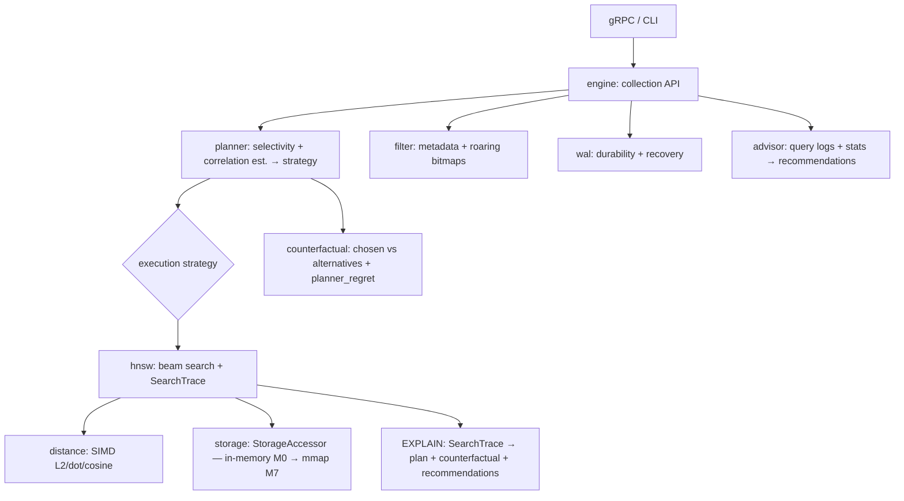

# Loupe

**An explainable filtered vector search engine.**

> Loupe plans each filtered ANN query, shows the rejected alternatives, and
> turns query logs into retrieval tuning advice.

It answers the questions engineers actually ask about filtered retrieval:
- *Why did my filtered vector query miss good results?*
- *Was post-filtering the wrong plan?*
- *Is this metadata filter anti-correlated with the vector space?*
- *Would another strategy have returned better results?*
- *What should I change next?*

Under the hood it's a real engine — disk-backed HNSW in Rust with SIMD distance,
mmap storage, and a write-ahead log — but the surface you touch is the planner,
`EXPLAIN SEARCH` (with counterfactuals), the query-log advisor, and replay tooling.

> 🚧 **Status: early development.** This README is a living skeleton — sections
> below fill in as milestones land.

---

## Why Loupe?

Real RAG/search is almost never *pure* vector search — it's vector search under
constraints (`tenant_id`, `doc_type`, `created_at > …`, permissions). HNSW is
built for graph traversal, and filters break the useful graph path; pre-filter
and post-filter each fail in different regimes.

Existing systems *optimize* filtered vector search, but they rarely make the
planner's reasoning — its **correlation assumptions, recall risk, and the
counterfactual alternatives** — visible to engineers. **Loupe does.**

| | pgvector | Pinecone | Weaviate | **Loupe** |
|---|---|---|---|---|
| Filtered search | one cost-based path (can misfire at scale) | managed, opaque | HNSW + ACORN (one fixed strategy) | **measures the query, picks among multiple strategies** |
| Explainability | `EXPLAIN` (SQL-level) | black box | limited | **`EXPLAIN SEARCH` + counterfactual: chosen plan vs alternatives, selectivity, correlation, recall risk** |
| Hard filters (0.1%, anti-correlated) | recall/latency cliffs | varies | ACORN mitigates | **ACORN-style traversal + adaptive ef, chosen per-query** |
| Cost | self-hosted | $$ usage-based | self-hosted / cloud | self-hosted, open |

In a line: **Qdrant / Weaviate / Pinecone *optimize* filtered search; Loupe makes it *inspectable, replayable, and tunable*.**

*(Decision tree — "when to reach for Loupe vs pgvector/Pinecone" — TODO once benchmarks land.)*

---

## Architecture

---

## Product surface

| Command | Question it answers |
|---|---|
| `loupe explain-search` | *Why this result?* — chosen plan + counterfactual alternatives for one query |
| `loupe advise` | *What's wrong across my workload?* — recommendations from query logs |
| `loupe replay` | *Did my change help?* — replay a saved workload, report regret + before/after |
| `loupe bench` | *How does it compare?* — synthetic (selectivity × correlation) + arXiv workloads → plots |

Plus the **Loupe Graph Explorer** *(optional capstone, M12)* — a 3D web view of a
single query's traversal path, built on a bounded trace-graph export from
`ExplainSearch`: watch the chosen plan's walk through the local HNSW subgraph vs.
the rejected alternatives', with filtered-out and top-k nodes color-coded.

## Under the hood

The observability layer is only meaningful because the engine beneath it is real:
- **HNSW** index — layered graph + beam search, generic over a storage accessor.
- **SIMD** distance — NEON on Apple Silicon, AVX2/AVX-512 on x86, with a scalar oracle.
- **mmap**-backed segments — search a sealed on-disk index with bounded RAM.
- **Write-ahead log** + checkpointing — crash recovery proven by `kill -9` mid-write.
- Tombstone deletes + **background compaction**.

---

## Status

| Milestone | Scope | State |
|---|---|---|
| M0 | In-memory HNSW + SearchTrace + storage accessor + bench skeleton | ⬜ not started |
| M1 | SIMD distance kernels (NEON / AVX) | ⬜ |
| M2 | Filtered search: the strategies | ⬜ |
| M3 | Correlation-aware benchmark matrix + arXiv corpus | ⬜ |
| M4 | Rule-based planner + EXPLAIN SEARCH (counterfactual + regret) | ⬜ |
| M5 | Competitor comparison: FAISS / Qdrant / Weaviate / pgvector | ⬜ |
| M6 | Query-log advisor | ⬜ |
| M7 | Disk-backed storage (mmap) | ⬜ |
| M8 | WAL + crash recovery | ⬜ |
| M9 | gRPC API + CLI (EXPLAIN + advisor) | ⬜ |
| M10 | Deletes + dead-node-aware search + compaction | ⬜ |
| M11 | Cost-based planner | ⬜ |
| M11.5 | Polish: DX & observability | ⬜ |
| M12 | *(optional capstone)* Loupe Graph Explorer — 3D retrieval trace view | ⬜ |

Legend: ⬜ not started · 🟡 in progress · ✅ done. *(Link PRs/issues here as work lands.)*

---

## Results

> TODO (M5): recall/QPS Pareto plots vs FAISS, Qdrant, Weaviate & pgvector, and
> the filtered selectivity × correlation matrix (synthetic + arXiv). The headline
> cell is **0.1% selectivity, anti-correlated** — where naive filtering collapses
> and Loupe's planner earns its keep.

## EXPLAIN demo

> TODO (M4): `loupe explain-search` on a nasty filter, showing the chosen plan,
> *why*, and the **counterfactual** (what the rejected alternatives would have cost).

## Quickstart / Reproduce

> TODO: one-command path to build, load a dataset, query, and reproduce the
> benchmarks from a clean checkout.

---

## License

TODO.
